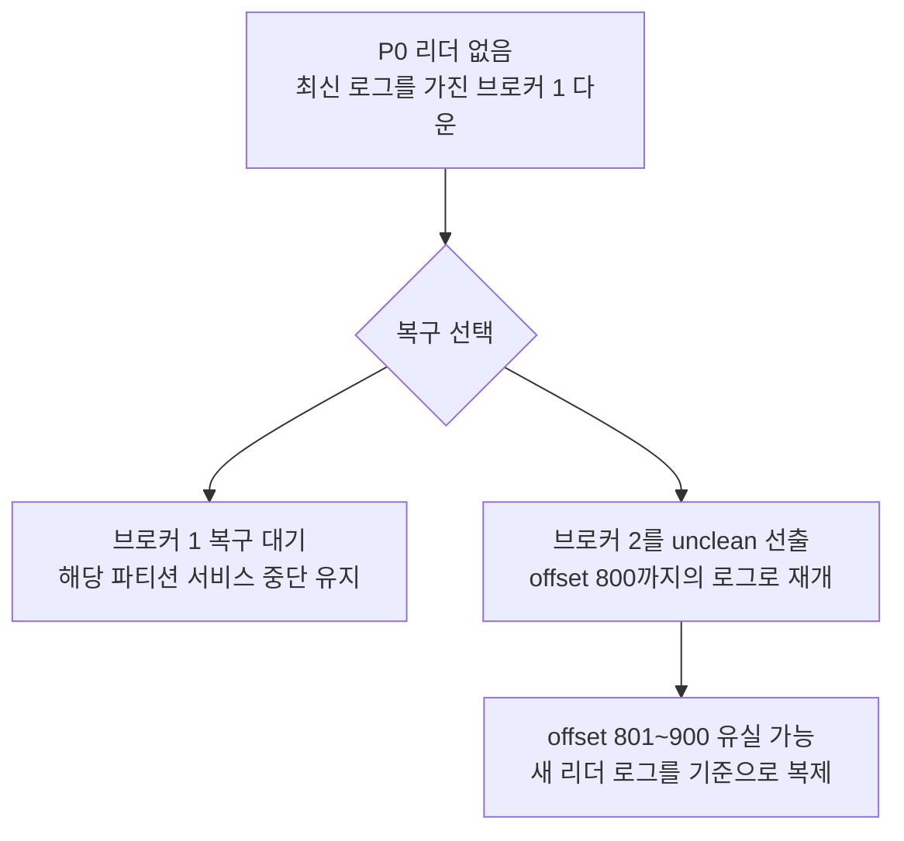

## 파티션 리더의 선출 자격

Kafka의 파티션은 여러 브로커에 복제되며, 그중 리더가 프로듀서의 쓰기와 기본적인 컨슈머 읽기를 처리한다. 리더 브로커가 내려가면 활성 컨트롤러가 다른 복제본을 새 리더로 선택하므로, 데이터를 가진 브로커가 남아 있어야 요청을 이어서 처리할 수 있다. 장애 감지와 변경 전파는 [KRaft와 컨트롤러](/posts/kafka-kraft-controller)에서 다룬다.

컨트롤러는 복제본의 동기화 상태와 서비스 참여 가능 여부를 함께 확인하며, 프로세스가 실행 중이어도 fenced 상태로 관리되거나 해당 복제본의 디스크에 문제가 있으면 선출 대상에서 제외한다. 데이터의 동기화 상태는 ISR과 ELR로 관리한다.

| 복제본 집합 | 관리하는 대상 | 선출에서의 역할 |
|---|---|---|
| ISR | 리더를 충분히 따라잡으며 복제에 참여하는 복제본 | 정상적인 리더 선출의 우선 후보 |
| ELR | ISR에서 빠졌지만 복제가 확정된 데이터를 보존한 복제본 | ISR이 비었을 때 사용할 수 있는 후보 |

ELR은 Eligible Leader Replicas로, Kafka 4.4의 새 클러스터에서 기본으로 활성화된다. ISR이 현재 리더를 따라가는 복제본을 관리한다면, ELR은 복제에서 빠졌어도 확정된 데이터를 보존한 후보를 남겨 두며, 두 목록 모두 KRaft의 파티션 메타데이터에 저장된다. [ELR 공식 문서](https://kafka.apache.org/44/operations/eligible-leader-replicas/)

브로커 1, 2, 3에 파티션 P0를 복제하고, 리더가 1이며 ISR이 `1,2,3`인 상태에서 장애가 발생하면 다음처럼 처리한다.

| 장애 상태 | 선출 결과 |
|---|---|
| 브로커 1 다운, 2와 3은 정상 | 2 또는 3의 복제본을 새 리더로 선택 |
| 브로커 2 다운, 1과 3은 정상 | 리더는 1로 유지, ISR에서 2 제외 |
| 브로커 2 복구 | 밀린 데이터를 복제하고 조건을 만족하면 ISR에 재합류 |

브로커가 복구되면 우선 팔로워로 밀린 데이터를 따라잡으며, ISR에 돌아온 뒤에도 현재 리더가 정상이라면 곧바로 리더를 넘겨받을 필요는 없다.

## ISR에서 빠진 복제본의 ELR 유지 조건

ELR에 남으려면 복제에서 빠진 뒤에도 확정된 데이터를 모두 가지고 있어야 하므로, 리더 혼자 새 데이터를 계속 확정하는 상황에서는 뒤처진 복제본을 후보로 유지할 수 없다. 이 조건을 관리하는 기준이 `min.insync.replicas`이며, ELR 활성화 상태에서는 ISR 개수가 이 값보다 작아질 때 high watermark의 전진을 멈춘다. high watermark는 복제가 확정돼 컨슈머에게 공개할 수 있는 로그의 경계다.

`min.insync.replicas=2`이고 브로커 1과 2가 offset 100까지 복제를 확정한 상태에서 2가 내려갔다고 가정한다.

| 시점 | ISR | ELR | 복제가 확정된 범위 |
|---|---|---|---|
| 1과 2가 정상적으로 복제 | `[1,2]` | `[]` | offset 100까지 |
| 2가 내려가 ISR에서 제외 | `[1]` | `[2]` | offset 100까지 유지 |

ISR이 최소 조건인 2개보다 적어지면 확정 범위가 더 나아가지 않으므로, 2는 복제에 참여하지 못해도 확정된 데이터 전체를 가진 후보로 남을 수 있다. 이후 1도 내려가고 2가 복구되면 ELR의 2를 리더로 선택해 offset 100까지의 데이터를 보존할 수 있다.

반면 `min.insync.replicas=1`이면 1만 남아도 새 데이터를 계속 확정할 수 있어, 100까지만 가진 2를 안전한 후보로 남겨 둘 수 없다. 컨트롤러는 ISR 개수가 최소 조건 이상이면 ELR을 비우고, 최소 조건 아래로 줄어들 때 제외된 복제본 중 조건을 만족하는 대상을 ELR로 관리한다. [ELR 갱신 구현](https://github.com/apache/kafka/blob/4.4.0/metadata/src/main/java/org/apache/kafka/controller/PartitionChangeBuilder.java#L490-L510)

### 프로듀서의 성공 응답과 복제 확정

프로듀서의 성공 응답 시점은 `acks`로 정하므로, `acks=1`이면 리더가 레코드를 기록한 뒤 팔로워 복제를 기다리지 않고 성공을 알릴 수 있다. `min.insync.replicas=2`를 쓰기 성공 조건으로 검사하는 것은 `acks=all`일 때라서, `acks=1`에서는 ISR이 부족해도 리더가 기록하고 성공 응답을 보낼 수 있다. [쓰기 성공 조건](https://kafka.apache.org/44/configuration/topic-configs/#min.insync.replicas)

리더 1이 offset 101을 기록하고 `acks=1`의 성공 응답을 보냈더라도, 2가 복제하기 전에 내려갔다면 복제 확정 범위는 여전히 100까지다. 이후 1까지 내려가 ELR의 2를 리더로 선출하면 확정된 100까지는 보존되지만, 1에만 있던 101은 잃을 수 있다. 이때의 커밋은 브로커 사이의 복제 확정을 가리키며, 컨슈머가 읽은 위치를 저장하는 오프셋 커밋과는 별개다.

## 리더가 없을 때의 선출 순서

컨트롤러는 ISR과 ELR에 기록된 후보의 상태를 확인하며 새 리더를 결정한다.

1. **ISR의 적격 복제본을 확인한다.** 정상적인 장애 전환은 동기화된 복제본을 우선한다.
2. **ISR이 비었으면 ELR을 확인한다.** ELR에 기록되고 서비스에 참여할 수 있는 복제본으로 커밋된 데이터를 보존하며 복구할 수 있다.
3. **ISR과 ELR이 모두 비었으면 마지막 리더의 복귀를 확인한다.** 컨트롤러에 기록된 마지막 리더와 복구 정책의 조건을 만족해야 한다.

복구 가능한 후보가 없으면 해당 파티션은 리더 없이 기다리며, 데이터 손실을 감수하고 뒤처진 복제본으로 서비스를 재개하려면 unclean 선출을 선택해야 한다.

## Preferred Replica와 리더 배치

장애 전환으로 옮겨간 리더를 복구된 브로커에 다시 분산할 때는 복제본 목록의 순서를 사용한다. `kafka-topics.sh --describe`에서 `Replicas: 1,2,3`으로 표시되면 첫 번째인 브로커 1의 복제본이 **preferred replica**이며, Kafka는 이 복제본이 선출 자격을 갖추면 리더로 우선 배치한다. [공식 운영 문서](https://kafka.apache.org/44/operations/basic-kafka-operations/#balancing-leadership)

토픽 `topic-p3r3`에 파티션 3개와 복제본 3개를 다음처럼 배치했다고 가정한다.

| 파티션 | Replicas | Preferred Replica | 초기 리더 |
|---|---|---|---|
| P0 | `1,2,3` | 1 | 1 |
| P1 | `2,3,1` | 2 | 2 |
| P2 | `3,1,2` | 3 | 3 |

브로커 3이 내려가 장애 전환을 마친 뒤 2도 내려가면 세 파티션의 리더가 모두 1로 모일 수 있으며, 2와 3이 복구돼 데이터를 따라잡은 뒤에도 리더가 1에 남아 있으면 읽기와 쓰기 부하가 계속 집중된다.

preferred replica로 리더를 옮기는 **Preferred Leader Election**을 수행하면 P1은 2로, P2는 3으로 옮겨 복제본 배치에 맞게 부하를 분산할 수 있다. 이때 기준이 되는 `Replicas`의 순서는 브로커 재시작으로 바뀌지 않지만, 복제본 재할당으로 목록을 바꾸면 preferred replica도 달라질 수 있다.

## Preferred Leader Election의 실행 조건

정상 리더와 ISR이 있는 상황에서는 preferred replica가 데이터를 따라잡아 ISR에 합류해야 리더를 넘겨받을 수 있으며, ISR이 비어 있으면 ELR의 적격 후보도 고려한다. Preferred Leader Election 역시 복제본의 자격을 검사하므로, 우선순위만으로 뒤처진 복제본을 리더로 올리지는 않는다. [Kafka 4.4.0의 선출 구현](https://github.com/apache/kafka/blob/4.4.0/metadata/src/main/java/org/apache/kafka/controller/PartitionChangeBuilder.java)

| 설정 | 역할 | 기본값 (Kafka 4.4) |
|---|---|---|
| `auto.leader.rebalance.enable` | preferred replica를 이용한 자동 리더 재배치 활성화 | `true` |
| `leader.imbalance.check.interval.seconds` | 컨트롤러의 리더 재배치 확인 주기 | `300`초 |

컨트롤러가 주기적으로 재배치를 확인하므로 실제 전환 시점은 확인 주기와 복제 진행 상태에 따라 달라지며, preferred replica가 아직 선출 자격을 얻지 못했거나 자동 재배치가 꺼져 있으면 복구 뒤에도 현재 리더가 유지될 수 있다. [공식 브로커 설정](https://kafka.apache.org/44/configuration/broker-configs/#auto.leader.rebalance.enable)

## 마지막 리더까지 내려간 상황

P0를 브로커 1, 2, 3에 복제하고 `acks=all`, `min.insync.replicas=1`로 쓰는 환경에서, 2와 3이 내려가 ISR에 1만 남았다고 가정한다. 최소 조건이 1이므로 리더 1은 계속 쓰기를 성공 처리할 수 있고, 복제가 멈춘 2와 3은 새로운 확정 범위를 따라가지 못해 ELR에도 남지 않는다. 쓰기 설정별 성공 조건은 [브로커와 복제](/posts/kafka-broker-replication)에서 다룬다.

| 복제본 | 기록된 마지막 offset | 상태 |
|---|---|---|
| 브로커 1 | 900 | 유일한 ISR, 리더 |
| 브로커 2 | 800 | 다운, ISR 밖 |
| 브로커 3 | 800 | 다운, ISR 밖 |

브로커 1까지 내려간 상태에서 2만 복구하면, 2에는 offset 801부터 900까지의 데이터가 없고 ELR에도 속하지 않아 정상적인 리더 선출 대상이 될 수 없다. P0는 리더가 없어 읽기와 쓰기가 멈추지만, 정상 리더가 있는 다른 파티션은 계속 동작한다.

최신 로그를 가진 브로커 1이 원래 디스크로 복구돼 재선출 조건을 만족하면 다시 리더를 맡고, 다른 복제본은 밀린 데이터를 가져와 따라잡을 수 있다. 반면 1의 디스크가 완전히 손상돼 복구할 수 없다면, 남은 오래된 로그로 서비스를 재개할지 결정해야 한다.

## Unclean Leader Election과 데이터 손실

최신 데이터를 가진 복제본을 복구할 수 없을 때 **Unclean Leader Election**을 허용하면 뒤처진 복제본으로 리더를 선출할 수 있다. 이 선택은 확정된 데이터도 잃을 수 있어 Kafka 4.4의 `unclean.leader.election.enable` 기본값은 `false`이며, 브로커의 기본 정책과 별개로 토픽별 허용 여부를 설정할 수 있다. [공식 토픽 설정](https://kafka.apache.org/44/configuration/topic-configs/#unclean.leader.election.enable)

P0에서 800까지 기록한 브로커 2를 리더로 선출하면 새 로그에는 801부터 900까지의 레코드 100개가 빠지며, 기존 리더 1이 나중에 복구돼도 그 데이터를 자동으로 합치지 않는다. 브로커 1은 팔로워로 합류하면서 새 리더의 로그에 맞춰 충돌하는 꼬리를 잘라낼 수 있어, 기존 디스크에 데이터가 남아 있더라도 정상 복제 과정에서 버려질 수 있다.

`acks=all`, `min.insync.replicas=1`에서는 유일한 ISR인 1에만 기록하고도 성공 응답을 보냈으므로, 그 데이터를 갖지 못한 2를 리더로 삼으면 성공한 쓰기도 잃게 된다. ELR 후보가 확정된 데이터를 보존하는 것과 달리, unclean 선출은 확정된 범위의 손실까지 감수하고 서비스를 재개한다.

리더가 생긴 뒤에도 쓰기는 현재 설정을 만족해야 하므로, 복구 시점에 `acks=all`, `min.insync.replicas=2`를 적용한다면 2 혼자 리더가 됐어도 다른 복제본이 ISR에 합류하기 전까지 성공할 수 없다.
